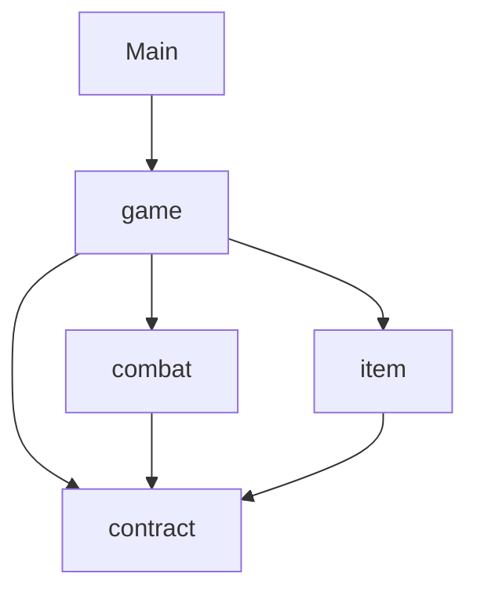
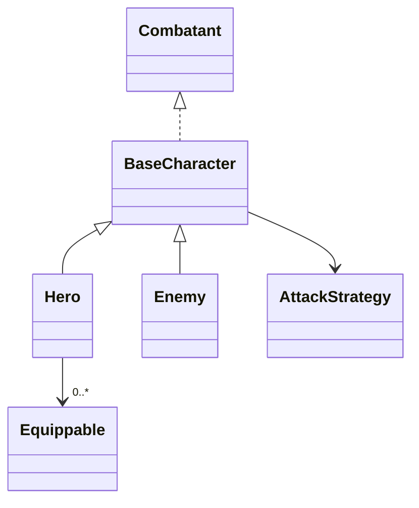
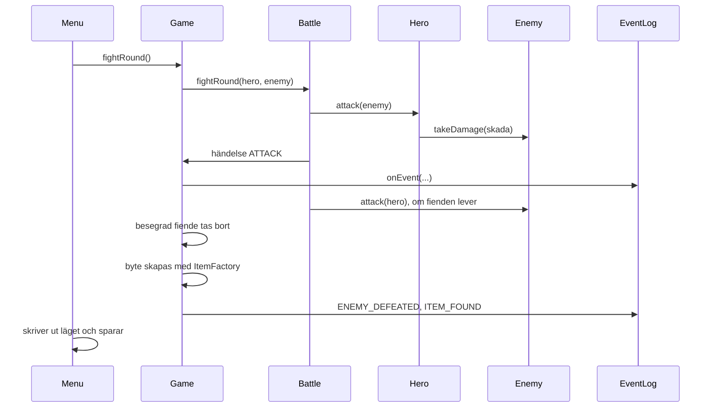

# Kodöversikt för Fångdjupet

Det här dokumentet förklarar i stora drag hur koden är uppbyggd: vilka delar som finns, hur de hänger ihop
och vad som händer när man spelar. Detaljerna finns i koden och i kommentarerna där.

## Översikt

Koden är uppdelad i fyra paket under `fangdjupet`:

| Paket | Ansvar |
|---|---|
| `contract` | De gemensamma typerna som modulerna kommunicerar genom |
| `combat` | Karaktärer, skadeberäkning och turordning i strid |
| `item` | Föremål och inventarium |
| `game` | Menyn, spelmotorn, händelseloggen och sparfunktionen |

`Main` ligger direkt i `fangdjupet` och sätter bara ihop delarna och startar menyn.

### Beroenden mellan paketen

Pilarna visar vem som känner till vem. Det viktiga är att `combat` och `item` inte känner till varandra.
De möts bara genom kontraktet. Det betyder att två personer kan arbeta i var sitt paket utan att störa
varandra, så länge kontraktet inte ändras. Det är `game` som sätter ihop allt.

## Paketet contract

Kontraktet innehåller bara interfaces, records och enums, alltså beskrivningar av vad saker kan göra,
inte hur de gör det.

| Typ | Beskriver |
|---|---|
| `Combatant` | Något som kan strida: har namn, hälsa, anfall och försvar, kan ta skada och anfalla |
| `AttackStrategy` | Ett sätt att räkna ut skada (Strategy-mönstret) |
| `Item` | Ett föremål med namn, nivå och typ |
| `ItemType` | Föremålstyperna: vapen, rustning och dryck |
| `Equippable` | Ett föremål som kan bäras och ger bonus till anfall och försvar |
| `GameEvent` | En händelse i spelet, med typ och meddelande |
| `GameEventType` | Händelsetyperna, till exempel `ATTACK` och `ENEMY_DEFEATED` |
| `GameEventListener` | Den som vill få veta när något händer (Observer-mönstret) |

`Equippable` är bryggan mellan föremål och strid. Ett vapen i `item` är `Equippable`, och hjälten i
`combat` räknar ihop bonusarna från allt `Equippable` den bär, utan att veta vad ett vapen är.

## Paketet combat

### Karaktärer

- **`BaseCharacter`** är en abstrakt klass med allt som hjälte och fiende har gemensamt: hälsa, att ta skada,
  att läkas och att anfalla. Anfallet frågar karaktärens `AttackStrategy` hur mycket skada det blir.
- **`Hero`** kan bära utrustning. Hjältens anfall och försvar är grundvärdet plus bonusarna från utrustningen.
- **`Enemy`** har en nivå, som avgör nivån på föremålet fienden lämnar efter sig.

### Skadeberäkning

| Klass | Skada |
|---|---|
| `MeleeAttack` | Anfall minus försvar |
| `RangedAttack` | Anfall minus halva försvaret |
| `MagicAttack` | Tre fjärdedelar av anfallet, försvaret räknas inte |

Alla tre använder `DamageRules`, som ser till att ett anfall alltid gör minst 1 i skada.
Strategierna räknar bara ut skadan. Det är `BaseCharacter.attack()` som drar av den från målets hälsa.

### Strid och fiender

- **`Battle`** sköter en stridsrunda: hjälten slår först, och fienden slår tillbaka om den överlever.
  Varje slag skickas som en `GameEvent`.
- **`EnemyType`** är en enum med fiendernas grundvärden på nivå 1.
- **`EnemyFactory`** skapar en fiende av en viss typ på en viss nivå (Factory-mönstret).
  Varje nivå över 1 ger mer hälsa, anfall och försvar.

## Paketet item

- **`AbstractItem`** innehåller det som alla föremål har gemensamt: namn och nivå.
- **`Weapon`** och **`Armor`** är `Equippable` och ger bonus till anfall respektive försvar.
- **`Potion`** är inte `Equippable`. Den bärs inte utan används, och vet bara hur mycket den läker.
- **`Inventory<T extends Item>`** är ett generiskt inventarium. Det kan filtrera på typ, på ett valfritt
  villkor eller på klass, till exempel `findAll(Potion.class)`, som returnerar en `List<Potion>` direkt.
- **`ItemFactory`** skapar föremål utifrån typ och nivå (Factory-mönstret). Namnen och bonusarna räknas
  fram från nivån.

## Paketet game

| Klass | Ansvar |
|---|---|
| `Menu` | Visar menyn, läser in val och skriver ut resultat. Innehåller ingen spellogik. |
| `Game` | Spelmotorn: hjälten, fiendekön, ryggsäcken, byte efter strid och drycker |
| `EventLog` | Lyssnar på händelser och skriver ut dem i konsolen, färgade efter händelsetyp |
| `ConsoleStyle` | Färger och utseende i konsolen: hälsostapel, rubriker och färger för händelser |
| `ConsoleColor` | Enum med ANSI-färgkoderna (American National Standards Institute) |
| `AdventureSetup` | Skapar hjälten och fienderna för ett nytt äventyr |
| `SaveManager` | Sparar och läser in ett äventyr som en textfil |
| `SavedAdventure` | En record med det som lästes in från sparfilen |
| `SaveGameException` | Undantaget för alla fel vid sparande och inläsning |

`Game` är "subject" i Observer-mönstret. Den har en lista med lyssnare, och `publish()` skickar varje
händelse till alla. `Main` registrerar `EventLog` som lyssnare.

## Vad som händer när man spelar

### Starta spelet

`Main` skapar `Game`, registrerar `EventLog` som lyssnare och skapar `Menu` med en `Scanner`, spelet,
en `SaveManager` och sökvägen till sparfilen. Allt som menyn behöver skickas in via konstruktorn.
Därför går delarna att testa var för sig.

### En stridsrunda (menyval 4)

1. `Menu` anropar `game.fightRound()`.
2. `Game` låter `Battle` köra rundan. `Battle` skickar en händelse för varje slag, och `EventLog` skriver ut den.
3. Om fienden besegrades tar `Game` bort den ur kön, skapar ett föremål med `ItemFactory` och antingen
   tar på det (om det är ett bättre vapen eller en bättre rustning) eller lägger det i ryggsäcken.
4. `Menu` skriver ut hjältens hälsostapel och hur många fiender som är kvar, och sparar äventyret.

### Färger och hälsostapel

Alla utskrifter som har färg går genom `ConsoleStyle`. Hälsan visas som en stapel med tio fält,
till exempel `[██████░░░░] 22/40`. Den är grön över 60 procent, gul över 30 procent och röd under det.
Stapeln avrundas uppåt, så att en hjälte som lever alltid har minst ett fyllt fält.
`EventLog` färgar händelsetypen: grönt för besegrade fiender och använda drycker, gult för hittade föremål,
rött när hjälten faller och cyan för övrigt.

`ConsoleStyle` kontrollerar en gång om miljövariabeln `NO_COLOR` är satt. Är den det skrivs texten ut utan
färgkoder. Det är en vanlig konvention för terminalprogram.

### Spara och fortsätta (menyval 2 och 0)

`Menu` anropar `SaveManager` automatiskt efter varje händelse och när spelaren avslutar.
`SaveManager` skriver en textfil med en rad för hjälten, en rad per föremål och en rad per fiende som är kvar.

Vid inläsning läser `SaveManager` raderna, återskapar hjälten och fienderna och skapar föremålen med
`ItemFactory`. Resultatet blir en `SavedAdventure`, som `Game.restore()` tar emot. Om något går fel kastas
`SaveGameException`, och menyn visar felmeddelandet i stället för att programmet kraschar.

## Designval i korthet

- **Kontraktet först.** Interfaces i `contract` gör att modulerna kan byggas parallellt och oberoende av varandra.
- **Tunn meny.** `Menu` sköter bara in- och utmatning. Logiken ligger i `Game`, och den går att testa utan inmatning.
- **Det som är svårt att styra skickas in.** `Scanner`, `PrintStream`, `Random` och sökvägen till sparfilen
  skickas in utifrån. I testerna kan de ersättas, till exempel med en `Random` som alltid väljer vapen.
- **Ingen duplicering.** Gemensamt beteende ligger på ett ställe: `BaseCharacter` för karaktärer,
  `AbstractItem` för föremål, `DamageRules` för minsta skada och `printHeroStatus()` i menyn för hjältens status.
- **Utseende på ett ställe.** Färger och hälsostapel finns bara i `ConsoleStyle`. Vill man ändra färgerna
  eller stapeln görs det där, och resten av koden påverkas inte.
- **Listor som inte kan ändras utifrån.** `getEquipment()`, `getItems()` och `getEnemies()` returnerar
  listor som inte kan ändras, så att innehållet bara kan ändras via klassens egna metoder.

## Bygga vidare

Några exempel på hur koden kan byggas ut, och var ändringen görs:

| Vad | Var |
|---|---|
| En ny anfallsstil | En ny klass som implementerar `AttackStrategy`, och en rad i `AdventureSetup` |
| En ny fiendetyp | Ett nytt värde i `EnemyType` |
| En ny föremålstyp | Ett nytt värde i `ItemType`, en ny klass i `item` och ett nytt fall i `ItemFactory` |
| Fler eller andra fiender i äventyret | `AdventureSetup.createEnemies()` |
| En ny lyssnare, till exempel en logg till fil | En ny klass som implementerar `GameEventListener`, registrerad i `Main` |
| Andra färger eller en annan hälsostapel | `ConsoleStyle` och `ConsoleColor` |
